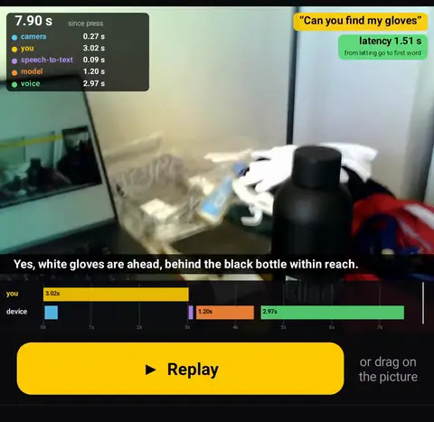
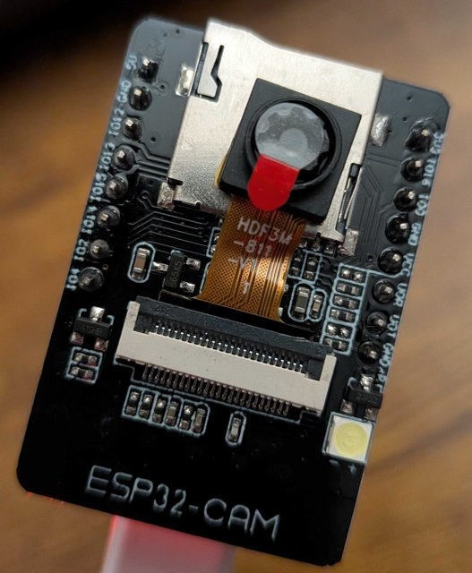
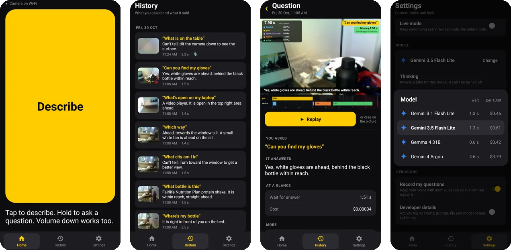
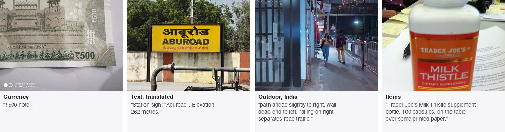
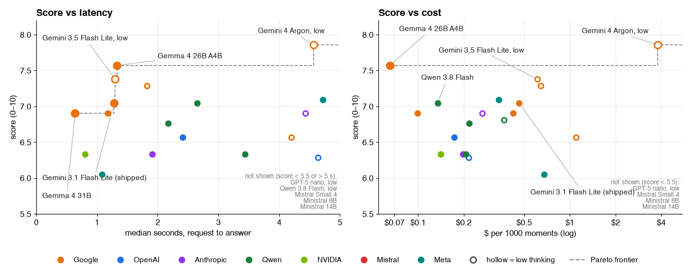

# sense

<!-- Keep this file under 200 lines. If it goes over, compress: tighten prose,
     drop what is no longer surprising, or move reference material to docs/. -->

A small camera that describes the world to a blind person through earphones. A thumb-sized
board with a camera sends photos to a phone; the phone asks a fast vision model and speaks a few
words. Tap for "what's in front of me", or hold and ask a question.

  

*"Can you find my gloves?" replayed in the app's History: the photo at the press, your hold,
speech-to-text, the model, and the answer, 1.51 s from letting go to the first word.*

**Setting it up?** [GETTING_STARTED.md](GETTING_STARTED.md) (from unboxing, no experience needed),
then [docs/workflow.md](docs/workflow.md) (live, replay, videos) and [phone/README.md](phone/README.md).

## Highlights

**Hardware.** An ESP32-CAM (2 MP OV2640, ~₹620 with its USB adapter, no soldering) runs a tiny
program: "take a photo" in, one JPEG out, over USB or the phone's hotspot. A 1024×768 photo
reaches the phone in 0.33 s. Next: the thumb-sized XIAO ESP32S3 on glasses.
[docs/hardware.md](docs/hardware.md)

**Phone app** (`phone/`, Android). Tap or volume-down to describe; hold to ask, with on-device
speech-to-text while you speak. About 1.5 s from letting go to the first spoken word, ~₹0.04 a
photo. History replays every moment with its timeline; Settings picks the model and thinking,
with measured cost and wait per model; light and dark themes.

  

**Camera glasses** (Bapick M08T, ~$60, HeyCyan family). Our own Bluetooth code (no vendor app)
takes photos, reads the buttons and mic, and speaks through the glasses' open-ear speakers. Sharper,
cleaner pictures than the ESP32, but slow: a photo takes 2.3–4.4 s over Bluetooth and the mic
blocks the camera, so describe took 5.5–8.4 s and ask 9.1 s (ESP32: ~1.5 s). [docs/glasses.md](docs/glasses.md)

| Glasses, Bluetooth | 320×180 | 384×216 | 512×288 | 640×360 |
|---|---|---|---|---|
| Photo, camera idle | 2.3 s | 2.7 s | 3.2 s | 4.4 s |

**Data.** Samples of 7 public datasets (EgoBlind, VizWiz, GuideDog India, Indian currency, Indic
signboards...), fetched file by file. From them, our own "moments": a frame where the user asked
nothing, and the one line the device should say, checked or rewritten by a person. Text in Indian
languages keeps the original and an English line.

| Category | Moments | Human-checked gold | From |
|---|---|---|---|
| Currency | 56 | 56 | Indian notes (Mendeley) |
| Text | 66 | 24 | IndicSTR12 (6 languages), Tamil Nadu buses, VizWiz, EgoBlind |
| Outdoor | 50 | 13 | GuideDog India (9 cities) |
| Items | 32 | 8 | VizWiz, EgoBlind |
| Home | 28 | drafts | our own sessions: people close, doors, head-height obstacles |
| **Total** | **232** | **101** | split train / dev / test by source |

**Hill-climbing.** One prompt, judged against the human gold by an LLM, train/dev/test held apart:
6.2 to 7.8/10 on dev (`moment_v4`, shipped), with failures mined from our own sessions back into
the set. Then 18 vision models (picked by price and Artificial Analysis latency) on the dev
moments; the app offers the ones on a frontier: Gemma 4 31B (fastest, 0.6 s), Gemini 3.1 and 3.5
Flash Lite, Gemma 4 26B A4B (cheapest, ₹0.006 a photo) and Gemini 4 Argon (most accurate, ~8× the
cost). [docs/evals.md](docs/evals.md)

**Every session is recorded** and can be replayed with a new prompt or model, or turned into a
video, without walking again. [Hold-to-ask video with sound](docs/media/phone-ask.mp4) (1:06, 8
questions); [the first walk](docs/media/phone-walk.mp4) (live mode).

## Where it stands (Nov 1 2026)

Plan in two tracks (software on today's rig, wearable hardware in steps): [docs/roadmap.md](docs/roadmap.md).
What testers said: [docs/feedback.md](docs/feedback.md).

- [x] Board over USB and Wi-Fi; laptop loop; Android app with Describe, hold to ask, History, Settings.
- [x] Board on a USB cable straight to the phone (no hotspot): 6/6 taps, ~2.1 s to the first word.
- [x] Evals: public samples, our moments set, prompt hill-climbing, model benchmark.
- [ ] Reproduce in India: same kit and steps with a collaborator ([GETTING_STARTED.md](GETTING_STARTED.md)).
- [x] HeyCyan-family glasses from a Mac: photos, buttons, mic and speakers with our own code; timed.
- [ ] Software on today's rig: sounds and vibrations, find mode, obstacle beeps, reading text.
- [ ] XIAO ESP32S3 Sense: mic, photo over Bluetooth to the phone (target under 0.5 s), battery draw.
- [ ] Clip-on with battery and Bluetooth; audio through bone-conduction headphones.
- [ ] Test with blind and low-vision interns.

What we learned (prompts, hallucinations, speed, light, Wi-Fi): [docs/findings.md](docs/findings.md).
Timings: [docs/benchmarks.md](docs/benchmarks.md).

## Layout

| Where | What |
|---|---|
| `GETTING_STARTED.md` | from unboxing to hearing it talk |
| `docs/workflow.md` | how it works; live, replay and video commands |
| `firmware/blink` | first program: blinks the board's red light |
| `firmware/camcheck` | checks the camera is attached and working |
| `firmware/snap` | photo on request over USB (the one to use) |
| `firmware/snapwifi` | the same plus Wi-Fi; needs `secrets.h` (see `secrets.h.example`) |
| `tools/describe.py` | the live loop on a laptop |
| `tools/replay.py`, `session_video.py`, `moment_timeline.py`, `judge_video.py` | offline: replay, videos, review |
| `tools/snap.py`, `shoot.py` | one photo; a photo per keypress |
| `tools/glasses.py`, `glasses_describe.py`, `glasses_ask.py` | camera glasses over Bluetooth: [docs/glasses.md](docs/glasses.md) |
| `tools/orclient.py` | every paid call: spend cap, ledger, attribution |
| `tools/enhance.py`, `speak_server.py` | brightening; fast voice on a Mac |
| `tools/bench_*.py`, `phone_bench.sh` | timing measurements |
| `tools/prompts/` | prompts, shared by the evals and the phone app (bundled at build time) |
| `tools/eval_sets.py`, `moments.py`, `climb.py`, `mine_sessions.py`, ... | evals: [docs/evals.md](docs/evals.md) |
| `phone/` | Android app ([phone/README.md](phone/README.md)) |
| `docs/` | hardware and buying, workflow, evals, findings, benchmarks, glasses, media |
| `sessions/`, `videos/`, `photos/`, `backups/`, `data/` | local recordings and eval data (not in git) |

Config: copy `.env.example` to `.env` and add an OpenRouter key. `.env`, `secrets.h` and
recordings never go into git.

## Future directions

Only added to when the owner asks.

- **Several photos while the user speaks.** In hold-to-ask, the camera takes 0.33 s (median) and the
  user holds for 1.70 s (median), so a single photo always finishes well before release. The spare
  time could fit 3–4 more photos, all sent with the question, at a higher model cost. The extra
  frames could give more detail (choose the sharpest, or combine them) or show motion (what is
  moving, which way the user is turning).
- **Blind and low-vision friendly app.** Today the phone app assumes the screen is on, the app is in
  front, and the user is sighted.
  - **Hands-free:** describe from an earphone or Bluetooth button with the screen off, so a ₹150
    selfie remote works as the small companion remote; also Pixel Quick Tap on the back of the phone,
    and a lock-screen shortcut.
  - **Works with TalkBack:** asking without a hold (a TalkBack action that stops when you go quiet),
    short labels, proper tabs and headings, spoken page changes, and no clash between TalkBack and the
    app's own voice.
  - **Speech settings:** speech rate, voice, how much detail, Hindi and other Indian languages.
  - **No visual-only feedback:** consistent sounds and vibrations for listening, thinking, error and
    camera lost.
  - Test with TalkBack and Accessibility Scanner, and with real blind and low-vision testers.

## License

© 2026 Avijit Thawani. [CC BY-NC 4.0](LICENSE): use and adapt with credit, not for commercial
purposes. Not covered, because they belong to others: the font in `worn-hackathon/deck/fonts/`
(its own licence is beside it) and the public-dataset photos shown in the deck.

## Rules for agents helping here

- **Setup and day-to-day commands live in [GETTING_STARTED.md](GETTING_STARTED.md) and
  [docs/workflow.md](docs/workflow.md)**; keep this README to highlights.

- **`## Future directions` is the owner's list.** Add to it only when the owner explicitly asks.

- **Check in software before asking for any physical step.** Probe the board first
  (`esptool chip-id`, `firmware/camcheck`); only ask for hands-on work if a probe fails.
- **Never tell anyone to take boards apart or touch connectors** unless a probe proved it is
  needed. Kits arrive assembled: camera ribbon latched, board on the programmer adapter.
- Physical instructions: one short step at a time, matched to a photo of *their* board.
- **Iterate offline first.** Prompt, model and setting changes get a replay and a video
  before asking anyone to walk around again. Never invent or reassign log data: if a photo
  or time is missing, say so.
- Before showing a video, have a video model review it (`judge_video.py`), and confirm what it
  flags on the frames; it misreads dark scenes.
- Paid calls only through `tools/orclient.py`. Uploads to the board at 115200 baud.
