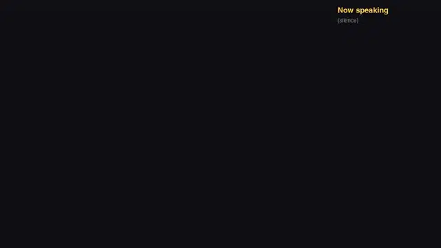

# sense

<!-- Keep this file under 200 lines. If it goes over, compress: tighten prose,
     drop what is no longer surprising, or move reference material to docs/. -->

A small camera that describes the world to a blind person through earphones. A thumb-sized
board with a camera takes a photo every second or two; a phone (or laptop) sends it to a fast
vision model and speaks a few words: "Person ahead, close. Chair left."

**New here? Start with [GETTING_STARTED.md](GETTING_STARTED.md).** You'll need the camera kit,
a micro-USB data cable, a laptop, and an [OpenRouter](https://openrouter.ai) key (the AI that
describes the photos; about ₹1 per minute).



[Full video with sound](docs/media/phone-walk.mp4) (40 s): the first walk with the phone app. Idle stretches longer than 6 s are cut to a short "skipped" card.
Left, each photo as it was taken; right, what was being spoken and how long ago that photo
was taken (about 1.9 s); bottom, the words heard. A video model's review of it is in
[phone-walk.judge.json](docs/media/phone-walk.judge.json) (8/10).

## Where it stands (Oct 28 2026)

- [x] **Board works over USB** (ESP32-CAM + programmer adapter, no soldering): photos in 0.36 s.
- [x] **Laptop loop**: photo → brighten → Gemini Flash Lite → spoken, **~1.7 s** end to end.
- [x] **Android app** (`phone/`): the phone powers the board and speaks into Bluetooth
      earphones, **~1.9 s** end to end. Photos come over USB, or over the phone's hotspot
      when the cable only carries power.
- [x] Every session is recorded and can be replayed with a new prompt or model, turned into
      a video like the one above, and graded by a video model, all without walking again.
- [ ] Collaborator in India: same kit, same steps ([GETTING_STARTED.md](GETTING_STARTED.md)).
- [ ] Data cable for the phone (USB-C to micro-USB, or an OTG adapter), so photos skip Wi-Fi.
- [ ] Push-to-talk questions: hold a button, ask "what does this sign say?", get an answer
      from the current photo; descriptions pause while you talk.
- [ ] Better pictures in dim rooms (light, exposure); app keeps running with the screen off.
- [ ] Log battery use per session; then move to the tiny XIAO ESP32S3 board on glasses.
- [ ] Test with blind users. Be My Eyes, Seeing AI and Envision set the bar.

What we learned getting here (prompts, hallucinations, speed, light, Wi-Fi):
[docs/findings.md](docs/findings.md). Raw timings: [docs/benchmarks.md](docs/benchmarks.md).

## How it works

```text
board (camera) --USB or Wi-Fi--> laptop or phone --> brighten --> Gemini Flash Lite
                                                                       |
                         earphones <-- voice <-- only things not said in the last 8 s
```

- The board runs a small program that waits for "take a photo" and sends one JPEG back.
- The model is asked for up to 3 things, most important first (people and hazards), with
  position, in a few words each, or SILENT if the photo is too dark to be sure.
- Up to 2 new things are spoken. A phrase is never cut off; the next photo is timed so its
  answer arrives as the current phrase ends.
- About ₹0.026 ($0.0003) per photo, roughly ₹1 per minute of use. Spending is capped.

## The working loop

**1. Live:** walk around with it.

```bash
cd tools && ../.venv-tools/bin/python describe.py
```

Keys: **l** live on/off, **Space** describe once, **r** photo size, **e** brightening on/off,
**c** mode, **q** quit. On the phone: **Live**, **Once**, **Connect**.

Every run is saved to `sessions/<date-time>/`: the photos, and `session.jsonl` with the prompt,
the answer, whether it was spoken (or why not), and when the photo was taken, answered and heard.

**2. Offline:** try a different prompt, model or setting on a recorded session.

```bash
../.venv-tools/bin/python replay.py items ../sessions/<dir> --enhance=auto   # ~$0.0003/photo
../.venv-tools/bin/python replay.py items ../sessions/<dir> --prompt="..." --tag=test
```

Add `--cached` to reuse answers already logged (free). Each replay writes a new session folder.

**3. Feel it:** turn any session into a video like the one above (free, local voice), then have
a video model review it before sharing:

```bash
../.venv-tools/bin/python session_video.py ../sessions/<dir> ../videos/<name>.mp4 "Title"
../.venv-tools/bin/python judge_video.py ../videos/<name>.mp4       # ~$0.02
```

Video format, the same every time so videos compare side by side: 1280×720; left, the photo as
taken with a timer; right, the photo being described and how its delay split (camera, model,
waiting, voice start); bottom, the spoken words while they are spoken. Idle gaps over 6 s (no photo, no speech) are cut to 1.5 s.

Phone sessions: `adb pull /sdcard/Android/data/com.sense.app/files/sessions/ sessions-phone/`.

## Layout

| Where | What |
|---|---|
| `GETTING_STARTED.md` | from unboxing to hearing it talk |
| `firmware/blink` | first program: blinks the board's red light |
| `firmware/camcheck` | checks the camera is attached and working |
| `firmware/snap` | photo on request over USB (the one to use) |
| `firmware/snapwifi` | the same plus Wi-Fi; needs `secrets.h` (see `secrets.h.example`) |
| `tools/describe.py` | the live loop on a laptop |
| `tools/replay.py`, `session_video.py`, `judge_video.py` | offline: replay, video, review |
| `tools/snap.py`, `shoot.py` | one photo; a photo per keypress |
| `tools/orclient.py` | every paid call: spend cap, ledger, attribution |
| `tools/enhance.py`, `speak_server.py` | brightening; fast voice on a Mac |
| `tools/bench_*.py`, `phone_bench.sh` | timing measurements |
| `phone/` | Android app ([phone/README.md](phone/README.md)) |
| `docs/` | hardware and buying, findings, benchmarks, example video |
| `sessions/`, `videos/`, `photos/`, `backups/` | local recordings (not in git) |

Config: copy `.env.example` to `.env` and add an OpenRouter key. `.env`, `secrets.h` and
recordings never go into git.

## Rules for agents helping here

- **Check in software before asking for any physical step.** Probe the board first
  (`esptool chip-id`, `firmware/camcheck`); only ask for hands-on work if a probe fails.
- **Never tell anyone to take boards apart or touch connectors** unless a probe proved it is
  needed. Kits arrive assembled: camera ribbon latched, board on the programmer adapter.
- Physical instructions: one short step at a time, matched to a photo of *their* board.
- **Iterate offline first.** Prompt, model and setting changes get a replay and a video
  before asking anyone to walk around again. Never invent or reassign log data: if a photo
  or time is missing, say so.
- Before showing a video, have a video model review it (`judge_video.py`), and confirm what it
  flags on the frames; it misreads dark scenes.
- Paid calls only through `tools/orclient.py`. Uploads to the board at 115200 baud.
