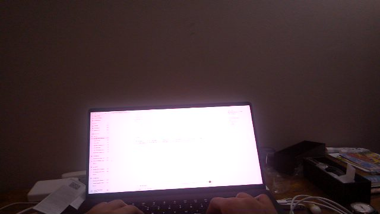
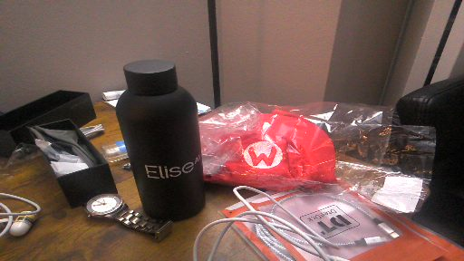

# Camera glasses (Bapick, M08T, Oct 30 2026)

A $60 pair of HeyCyan-family AI glasses (sold as Bapick on Amazon; vendor app "Prism Pro"):
camera, two mics, open-ear speakers, photo button, talk button, touch strip, 300 mAh battery.
Chips: Jieli JL7018 (Bluetooth, audio) and Allwinner V821 (camera). Firmware
`AQC14M08_1.00.06_260819`, Wi-Fi firmware `1.00.16`. The glasses have no AI of their own; the
vendor app sends photos and audio to a cloud model.

We drive them with our own code (`tools/glasses.py`), no vendor app or vendor library. All
numbers below were measured on Oct 30 2026 with the glasses talking to a Mac over Bluetooth LE.

  
  

*Left: 640×360 preview over Bluetooth, dim room, 4.4 s. Right: 512×288; the model answered
"Bottle "Elise AI" center, close." and, asked by voice what it says, "It says "Elise"."*

## Verdict

Much better pictures than the ESP32-CAM (sharp, low noise, no motion blur in a dim room), but
**3–9× slower**: every photo wakes the camera (~1.3 s) and crawls over Bluetooth at ~6 KB/s, and
the glasses' mic blocks their camera. The ESP32 on the phone hotspot: 0.33 s per photo, ~1.5 s
from letting go to the first spoken word.

| Flow | Glasses (BLE) | ESP32-CAM on hotspot |
|---|---|---|
| One photo, camera idle | 2.3 s (320×180) to 4.4 s (640×360) | 0.33 s (640×480) |
| Describe, press to answer | 5.5–8.4 s (text) | ~1.5 s (spoken) |
| Ask, end of question to answer | 9.1 s (text) | ~1.5 s (first spoken word) |

## Photo over Bluetooth (camera idle)

`glasses.py photo out.jpg N`: the size byte N sets the width, 256 + 64·N, at 16:9.

| N | Size | Bytes | Command to JPEG |
|---|---|---|---|
| 1 | 320×180 | 6.0 KB | 2.3 s |
| 2 | 384×216 | 7.3 KB | 2.7 s |
| 3 | 448×252 | 9.4 KB | 2.9 s |
| 4 | 512×288 | 11.0 KB | 3.2 s |
| 6 | 640×360 | 18.5 KB | 4.4 s |

- Command acknowledged in 0.06–0.10 s; "photo taken" event at 1.29–1.46 s; then 1 KB chunks,
  each its own request and reply, ~170 ms each (~6 KB/s).
- The glasses serve a fixed buffer (16 KB; 32 KB for larger sizes). The JPEG ends early; the rest
  is 0xaa padding or leftovers of an earlier photo. We stop at the JPEG's end (first ffd9 after
  start-of-scan). Before that fix some downloads pulled the whole 32 KB.
- Busy scenes compress worse: 512×288 previews of a cluttered desk were 15–30 KB, not 11 KB.
- The full photo (over the glasses' Wi-Fi, via the vendor app) is 6400×4800, 8.3 MB, no camera
  make or model in EXIF. It is upscaled: shrinking to ~2100×1600 and back loses almost nothing,
  so ~2–3 MP of real detail (dim room). Vendor tuning files point to a Sony IMX386; unconfirmed.

## Describe (`tools/glasses_describe.py`, Mac speaking through the glasses)

Prompt and model as `describe.py` (`google/gemini-3.1-flash-lite`). Times from the trigger
reaching the Mac; the glasses were also connected to the Mac as Bluetooth audio.

| Trigger | Photo | Model | Total | Answer |
|---|---|---|---|---|
| start | 4.8 s | 1.0 s | 5.8 s | SILENT (blank wall) |
| photo button | 7.0 s | 1.0 s | 8.0 s | Bed, pillows, lamp, center. |
| photo button | 7.0 s | 0.9 s | 7.9 s | Bottle "Elise AI" center, close. |
| start | 4.5 s | 1.0 s | 5.5 s | Black bottle, front left. |
| photo button, polling its own photo first | 7.9 s | 1.1 s | 9.0 s | Trash can, bottom center. Mirror, right. |
| photo button, polling its own photo first | 10.6 s | 1.0 s | 11.6 s | "Elise" bottle, center. |
| start | 6.8 s | 1.6 s | 8.4 s | Person upper right, close. Phone stand, center. |

- **The photo button cannot be the trigger.** The glasses' firmware takes and saves its own full
  photo on every press (one shutter sound); its preview never became available over Bluetooth
  (polled ~4 s: "no thumbnail"). So a press costs a second photo (a second shutter) and the
  answer describes that second photo. A swipe on the touch strip also sends an event and takes
  no photo; it is the trigger in the scripts now (it also changes the volume one step).

## Ask (`tools/glasses_ask.py`)

Talk button starts the glasses' mic stream (Opus over BLE, 16 kHz); we stop after 0.8 s of quiet,
send the audio itself plus a photo to the model with `prompts/ask_app_v1.txt` (no speech-to-text).

| Talked | Photo | Model | End of question to answer text | Answer |
|---|---|---|---|---|
| 3.4 s | after the question (camera refused during mic) | 1.7 s | 9.1 s | It says "Elise". The bottle is within reach, straight ahead. |

- Offline check, same model, recorded question "What does the bottle say?" plus a glasses
  preview: 1.35 s, "It says "EliseAI". The text is on the bottle straight ahead."
- **Camera and mic cannot run together** on these glasses (tested: the photo fired at the press
  failed). Untested way around: record from the phone's or Mac's mic (or the glasses as a plain
  Bluetooth headset) so the camera is free during the question.

## What we can control

| Feature | How | Status |
|---|---|---|
| Preview photo, chosen size | `41: 02 01 06 N N`, then `fd: 01 <chunk>` | measured above |
| Battery, firmware | `42`, `43` | works (92%, firmware string) |
| Volume levels | `51: 01` | works (music 7/16, call 12/16, system 12/16) |
| Stored photo/video counts | `41: 02 04` | works |
| Video recording | `41: 02 01 02` / `02 01 03` | works (video count 0 → 1) |
| Glasses' Wi-Fi on/off | `41: 02 01 04 02` / `02 01 09` | works: returns network `M08T_<mac>`, password `123456789`; stored photos download over it (see below) |
| Find device | `41: 02 01 0d` | accepted; nobody checked for a sound |
| Talk button | event `03` start, `0a` end (glasses end it after silence) | works |
| Mic audio | `59` packets, 40-byte Opus frames | decoded, sent to the model |
| Photo button | event `01` "media count changed" | works, but see Describe |
| Swipe forward/back | event `12`, volume up/down | works |
| Tap, double tap | none seen over BLE | probably play/pause over Bluetooth audio |
| Speaker | the glasses as a Bluetooth audio device (`blueutil --connect`, `say -a M08T_0A56`) | works; muffled if the Mac also uses them as its mic |

Button events only arrive after the vendor app's connect sequence (`Glasses.handshake()`: clock,
info, classic-Bluetooth check, battery, volume) and a heartbeat (`45: 04 01`) every 5 s.

## From the phone app (Nov 16 2026)

`GlassesCamera.kt` is `tools/glasses.py` in Kotlin: Settings → Camera → Photos over → *Glasses*.
Photo test (`--ei bench 5`, no model calls) on a Pixel 9a, medians of 5, trigger to JPEG:

| Size byte | Size | Bytes | Trigger to JPEG | Photo ready | Chunks |
|---|---|---|---|---|---|
| 0 | 160×90 | 3.6 KB | 1.8 s | 1.3 s | 4, 95–150 ms each |
| 1 | 320×180 | 9.2 KB | 2.5 s | 1.3 s | 10, 95–150 ms each |

- Size byte 0 is 160×90, not 256×144 (the 256 + 64·N rule starts at N = 1).
- No stalls in 19 photos. From the Mac the same evening, 2 of 3 runs had a chunk reply that
  came seconds late or never; the phone asks again after 0.7 s and never needed to.
- `CONNECTION_PRIORITY_HIGH` changes nothing (1.82 vs 1.80 s, 2.56 vs 2.50 s): the glasses set
  the pace. MTU 517. Connecting takes 2.4 s.
- The camera's 1.3 s is now most of the time; a smaller photo can't buy much more.
- Not tested: a describe or ask through this camera, whether 160×90 is enough for the model,
  the glasses' buttons as the trigger, a long idle (no heartbeat is sent).

## Photos over the glasses' own Wi-Fi (Nov 16 2026)

Found by reading the vendor app's strings (HTTP on port 80, RTSP `:8554/ch0` and `/ch4`,
Wi-Fi Direct plus a hotspot mode), then tried with `tools/glasses_wifi.py`.

1. `glasses_wifi.py on 150`: Wi-Fi on over Bluetooth, and keep the Bluetooth session open. The
   network went away both times the session ended, and stayed up while it was held.
2. Join `M08T_<mac>`; the glasses are `192.168.31.1` and hand out `192.168.31.100`.
3. `GET /files/media.config`: the stored photo and video names, one per line.
4. `GET /files/<name>`: the file. A 3200×2400 JPEG (418 KB) took 0.31, 0.48 and 0.75 s.

- That was a photo stored days earlier. Not tested: take a photo, then fetch it (the camera's
  1.3 s and the time to save come on top).
- Starting the Wi-Fi and joining takes about 10 s, so it only helps if the Wi-Fi stays on.
- Port 8554 was closed in this mode; the live stream probably needs its own command.
- From an Android phone the traffic goes to mobile data unless the app binds to this network
  (it has no internet); for the test, mobile data was switched off.
- The glasses show no USB device to a Mac over their charging cable.

## Protocol

Packets: `bc <cmd> <len LE16> <crc16 LE16> <payload>`, CRC-16/MODBUS of the payload (checked
against 37 captured packets). Written to `de5bf72a-…`, replies notify on `de5bf729-…` (service
`de5bf728-d711-4e47-af26-65e3012a5dc7`). Learned from a Bluetooth capture of the vendor app on
the phone (Android HCI snoop log), the [nisaetus notes](https://github.com/pepebot-space/nisaetus/blob/main/ARCHITECTURE.md)
and [Harish Barathi's write-up](https://www.harishbarathi.in/blog/reverse-engineering-heycyan).
The vendor app bundles an authentication library, but no handshake appeared on the wire.
